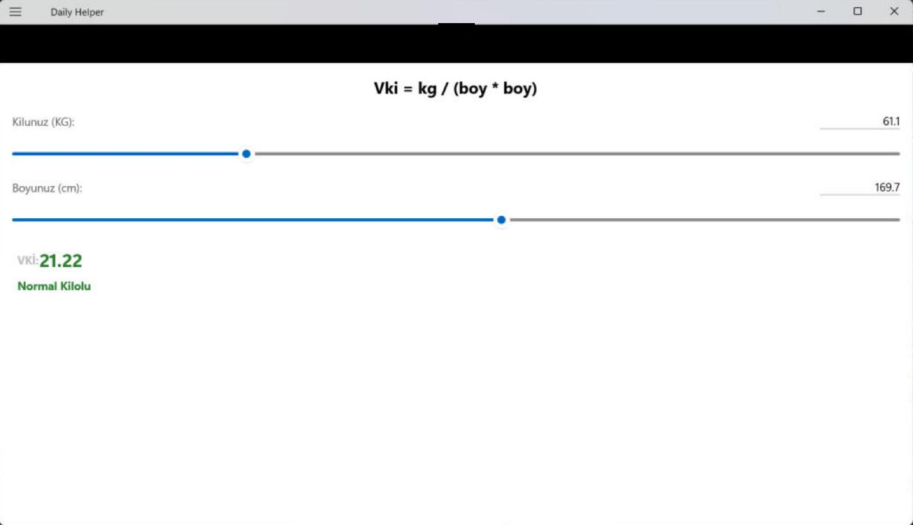
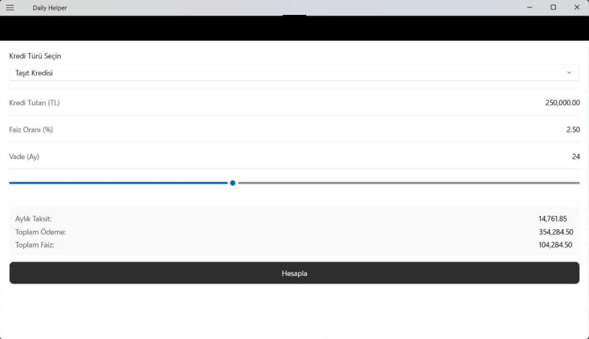
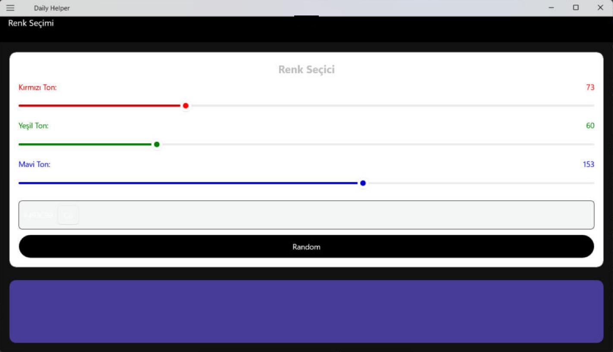

# Daily Helper

A .NET MAUI utility app with everyday calculators in one place.


## Screenshots

| Home | BMI calculator |
|---|---|
|  |  |

| Loan calculator | Color picker |
|---|---|
|  |  |

## Tools

- **BMI calculator** (VKİ Hesaplama): enter height and weight to get your body mass index
- **Loan calculator** (Kredi Hesaplama): choose a loan type, amount, interest rate and term, and see the monthly installment, total interest and total payment
- **Color picker** (Renk Seçici): mix red, green and blue with sliders, generate a random color, and copy its hex code

## Run

Requirements: .NET 10 SDK with the MAUI workload (included in Visual Studio's ".NET Multi-platform App UI development" workload).

```bash
dotnet workload install maui
dotnet build -t:Run -f net10.0-windows10.0.19041.0   # Windows
dotnet build -t:Run -f net10.0-android               # Android
```

On Windows, turn on Developer Mode (Settings → System → For developers) to run the app from Visual Studio.

---

Made by [Mariam Mahmoud](https://github.com/mar7233) · Computer Engineering, Bartın University
